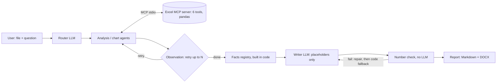

# DataPilot

**What:** upload an Excel/CSV file, ask a question in plain English, get a short answer and a Markdown/DOCX report.
**Why:** language models are bad at arithmetic, so here the model only plans and writes; every number is computed by a tool.
**How it stays honest:** the report writer uses placeholders (`{{F3}}`), code swaps in the real figures, and a no-LLM number
check rejects any digit that is not in a tool result. The language model is reached through OpenRouter (see the privacy note below); the tools, your files and the report stay on your machine.



> **Privacy: do not upload confidential data.** With OpenRouter, column names, the 5-row preview from `load_data`, tool results
> and `run_pandas` output (up to 20 rows) are sent to OpenRouter and the model provider. The app asks you to confirm this
> before every run.

Project context and rules: `docs/CONTEXT.md`. Progress: `docs/PROGRESS.md`. Deployment: `docs/DEPLOY.md`.

## Quickstart

You need an OpenRouter API key (https://openrouter.ai/keys) with a little credit. The key is read **only** from the
environment variable `OPENROUTER_API_KEY`; DataPilot never logs, prints, stores or shows it.

Linux / macOS:

```bash
python -m venv .venv && source .venv/bin/activate
pip install -r requirements.txt
export OPENROUTER_API_KEY=...            # your key
streamlit run app.py
```

Windows PowerShell:

```powershell
python -m venv .venv; .\.venv\Scripts\Activate.ps1
pip install -r requirements.txt
$env:OPENROUTER_API_KEY = "..."          # your key
streamlit run app.py
```

Settings (all optional except the key): `OPENROUTER_MODEL` (default `openai/gpt-4o-mini`; `MODEL_NAME` is accepted as an alias;
the model must support tool calling), `OPENROUTER_TIMEOUT_S` (default 120), `DATAPILOT_IDLE_MINUTES` (30) and
`DATAPILOT_MAX_SESSIONS` (5). Transport errors (429, 5xx, timeouts) are retried twice by the client.

## Safety rules

* The LLM never does arithmetic; tools return numbers, the report only contains numbers found in tool results.
* A number check (no LLM) runs on the report text; failures are repaired once, then replaced by a sentence built in code.
* Tools read only `DATA_DIR` and write only `OUTPUT_DIR`; the full files never leave your machine, only a data summary goes to the model (see "What leaves your machine"). The API key comes only from the environment and is never shown or stored.
* Tools never raise (they return `{"error": ...}`); logs never contain raw data rows.

## Limitations (honest)

* Language models are nondeterministic: the same question can pass in one repeat and fail in another (the eval counts repeats). Results depend on the chosen OpenRouter model, which can change over time.
* An external API means cost, rate limits and a privacy trade-off: do not upload confidential data.
* "tool_correct" (the right figure came out of a tool) is easier than "report_correct" (it reached the report); read both.
* Evaluated on 2 datasets and 20 questions only; results do not generalise automatically.
* The app has no login. Do not expose it to the internet without an authenticating proxy.
* `run_pandas` is a guardrail (restricted snippet, timeout), **not** a sandbox. Do not give it to untrusted users.

## Tools

| Tool | What it does || Tool | What it does |
|---|---|
| `list_sheets` | sheets of an `.xlsx`/`.csv` with row and column counts |
| `load_data` | loads a sheet server-side, returns `dataset_id` + profile (preview max 5 rows) |
| `aggregate` | sum/count/mean/median/min/max/nunique with filters, period, group_by, freq, top_n |
| `compare_groups` | Pearson correlation, Welch t-test, one-way ANOVA |
| `run_pandas` | short pandas snippet on a copy of `df` (guardrail, **not** a sandbox) |
| `make_chart` | bar/line/hist/scatter PNG saved in `outputs/charts/` |

## Setup

```bash
python -m venv .venv && source .venv/bin/activate   # Python 3.10+
pip install -r requirements.txt
```

## Your data (no sample data is bundled)

Put your own `.xlsx`/`.csv` files in `data/`. Tools read only inside `data/`, never modify your
files, and write only to `outputs/` (both gitignored). Override with `DATA_DIR` / `OUTPUT_DIR`.

## Tests

```bash
pytest -q
```

Tests build tiny files in a temp folder, need no network and never touch `data/`. The smoke test
starts the real server over stdio and calls `list_sheets -> load_data -> aggregate` in one session.

## Run the server

```bash
python excel_server.py                    # MCP over stdio; stdout is reserved for the protocol, logs go to stderr
DATA_DIR=/path/to/files OUTPUT_DIR=/path/to/out python excel_server.py
npx @modelcontextprotocol/inspector python excel_server.py   # browse the 6 tools in the Inspector
```

## Run the agent

The agent is a LangGraph loop (load -> router -> agents <-> tools -> observe -> decision) whose agents are
MCP clients of `excel_server.py`. It spawns the server itself, so you do not start it separately.
The language model is OpenRouter (an OpenAI-compatible API); there is no local-model option.

```bash
export OPENROUTER_API_KEY=...                 # PowerShell: $env:OPENROUTER_API_KEY = "..."
python run.py --file sales.xlsx --sheet orders "total amount by region, and a bar chart" --max-retries 2
python run.py --file sales.xlsx --model anthropic/claude-3.5-haiku "how many rows?"     # any OpenRouter model id with tool support
```

`--model` overrides `OPENROUTER_MODEL`. Configuration problems print one clean line (no stack trace, never the key) and
exit with code 2: key missing ("OPENROUTER_API_KEY is not set"), key rejected (401/403), no credits (402), model not found,
rate limited (429, wait and retry). Small models are weaker at structured output, so the router retries once with the parse
error appended before it gives up.

`--file` is a name inside `data/`; `--sheet` defaults to the first sheet; `--max-retries 0` turns retrying off.
The trace (`ROUTER`, `TOOL name args`, `OBSERVE -> RETRY(...)/NEXT TASK/FINISH`) and the answer print to stdout;
the server's one-line-per-call logs go to stderr (`2>/dev/null` hides them). Neither contains raw data rows.
The tests need no key and no network (they use a scripted model).

## Run the app

```bash
pip install -r requirements.txt
export OPENROUTER_API_KEY=...
streamlit run app.py
```

Pick a model in the sidebar (a short list of tool-capable models, or type any OpenRouter model id), press **Check key and model**, tick "I understand my data summary is sent to an external API", upload an
`.xlsx` or `.csv` file (max 25 MB), choose the sheet (only the schema is shown, never data rows), type your request
and press **Run**. The trace updates live while the agent works. The result shows a short answer and a report
preview with its charts. **Download DOCX / Markdown** stay disabled until you tick "I reviewed this report".

Each browser session gets its own analysis server and its own private folders `DATA_DIR/<session id>/` and
`OUTPUT_DIR/<session id>/` (defaults `./data` and `./outputs`), so users never see each other's files.
"Start a new session" in the sidebar stops the server and deletes the uploaded files.
Works on Windows and Linux (no signals, no fork).

**Troubleshooting**

* **"API key: not found":** set `OPENROUTER_API_KEY` in the shell that starts the app, then restart it. Run stays disabled until then.
* **"the key was rejected":** the key is wrong, revoked or has a typo (401/403). **"no credits":** add credits to your OpenRouter account (402).
* **"model not found":** check the id on openrouter.ai/models. **"does not support tools" / router parse errors:** pick a model that
  lists `tools` in its supported parameters.
* **"rate limited":** wait and retry (429); the client already retried twice. A long evaluation waits and retries a rate-limited run itself.
* **"Cannot reach OpenRouter":** network or proxy problem; the run is stopped after 10 minutes with a clear message.
* **Many "retry" or "number check" messages with a small model:** small models follow the placeholder format less
  reliably; the report still never contains a number that is not in the results (affected sections are built in
  code and listed in Caveats). A larger model gives better text.

## Report

Add `--report` to also get a Markdown report (`OUTPUT_DIR/reports/report_<timestamp>.md`; the path prints after the answer):

    python run.py --file sales.xlsx --sheet orders --report "total amount by region and a chart"

Every number in it comes from a tool. Code builds a list of facts (`F1`, `F2`, ...) from the clean results only; the
language model writes the narrative with placeholders such as `{{F3}}` and never types a number; code swaps in the
figure. A number check (no LLM) runs on the text before it is rendered: unknown placeholders, stray digits and missing
sections go back to the model for up to 2 rounds, and anything still failing is replaced by a sentence built in code,
which is noted in Caveats. Years (1990-2100), `Q1`-`Q4`, dates and list markers are allowed.

Sections: Title, Summary, Key figures (table), Analysis, Charts, Caveats (failed tasks, retries and self-corrections,
rows dropped for missing values, number-check fallbacks, causal wording, a line saying figures were computed by tools),
and a Sources appendix (fact id, tool, arguments, tool_call_id; `run_pandas` output appears only there). With no clean
results the report is built from code alone and says nothing could be verified. Chart links are relative to the report.
The report is built on your machine; only the model calls go to OpenRouter (see "What leaves your machine").

## Evaluation

20 questions (10 per dataset) with ground truth computed in plain pandas: `eval/questions.py`. Put the two datasets
in `eval/data/` (gitignored): `shopping_trends.csv` and `SeoulBikeData.csv`. Scoring is code only (no LLM):
`eval/scoring.py`. The evaluation runs through OpenRouter, so it needs `OPENROUTER_API_KEY` and **costs money** (see below).

**Warning: a full run makes hundreds to a couple of thousand paid model calls** (20 questions x 2 settings x 3 repeats = 120 runs, each one a
router call, tool calls and a report). Start small and run it in the background:

```bash
python -m eval.run_eval --name try --dry-run                 # print the plan and the run count (120), runs nothing
python -m eval.run_eval --name try --limit 4 --repeats 1     # 4 runs first: it prints the time per run and an ETA
python -m eval.summarize eval/results/try                    # look at the numbers
# choose --repeats from the measured time per run, then run it in the background
nohup python -m eval.run_eval --name full --settings 0 2 --repeats 3 > full.log 2>&1 &
```

Options: `--settings 0 2` (the `max_retries` values to compare), `--repeats N`, `--only id1,id2`, `--limit N`,
`--timeout-s 300` (per run), `--model ID` (an OpenRouter id; overrides `OPENROUTER_MODEL`), `--concurrency N` (1 to 4, default 1: each worker has its own
server and folders). A run that does not finish in time is recorded as a timeout; a run that OpenRouter rate limits is waited for
and retried (30 s, 60 s, 120 s) and only counts as `rate_limit` once those retries are used up. The command refuses to start
without a key, with a rejected key, or with a model id that does not exist or has no "tools" support.

**Cost and calls.** Every record in `runs.jsonl` has `llm_calls` (chat-model calls of that run). `--dry-run` prints an
ESTIMATE of the calls for the plan: from the measured mean when the run folder already has records, otherwise an assumed range
that is not a measurement. Run the 4-run slice first and read the real mean.

**Resume.** Every finished run is appended to `eval/results/<name>/runs.jsonl` at once. Stop with Ctrl+C (or if the
machine dies) and run the same command again: finished (question, setting, repeat) combinations are skipped. Use a new
`--name` to start over or to change the model. `meta.json` records the model, git commit and date (never the key).

**Reading `summary.md`** (written by `python -m eval.summarize <run_dir> [--compare <other_run_dir>]`, with a bar chart
`accuracy_by_setting.png`):

* `tool_correct`: every expected figure is in a clean tool output (relative tolerance 1e-3, group values under their
  own label). `report_correct`: the matching figure is in the report's Key figures table. `completion`: no error or timeout.
* The table shows `k/n (%)` per `max_retries` setting plus mean retries, self-corrections and latency. "Retry on vs off"
  is the highest setting minus the lowest, in percentage points.
* "Flaky questions" passed in some repeats and failed in others. "Failure reasons": `wrong_value`, `no_tool_call`,
  `tool_error`, `timeout`, `crash`. "Fabricated runs": a number-check fallback in the report, or figures on an
  unanswerable question (those must produce zero figures or a clarification).
* "CV bullets" is one paragraph built only from the computed numbers; do not edit the numbers by hand.

**Results in this README.** `python -m eval.summarize <run_dir> --update-readme` rewrites the block below from the
run's data (add `--compare <earlier_run>` to keep a before/after pair). Nothing in it is typed by hand.

<!-- EVAL:START -->
<<<<<<< HEAD
No evaluation has been run yet. TODO(results): run the eval, then `python -m eval.summarize eval/results/<name> --update-readme`.
=======
## Verification Status

**Model tested:** `openai/gpt-4o-mini` via OpenRouter  
**Date:** October 17, 2026  
**Status:** Core functionality verified, full evaluation pending

### ✅ Verified Working

1. **Basic Analysis Pipeline**
   - MCP server communication functional
   - Tool calls executing correctly (tested with `aggregate`)
   - Report generation working
   - Number verification system operational

2. **Sample Test Run**
   - Dataset: 7-row sales CSV (product, region, amount, quantity)
   - Query: "Total amount by region"
   - Results: All 4 regional totals computed correctly
   - Report: Generated successfully with proper fact tracking
   - Latency: ~2-3 seconds for simple aggregation

3. **Report Quality**
   - ✅ All figures sourced from tool outputs (no LLM-generated numbers)
   - ✅ Fact registry working (F1-F6 tracked correctly)
   - ✅ Key figures table populated accurately
   - ⚠️ Minor: Event loop closure caused narrative fallback (figures unaffected)

### 📋 Full Evaluation Status

**Pending:** Comprehensive evaluation on standard datasets requires:
- `shopping_trends.csv` - Public shopping dataset (~3,900 rows)
- `SeoulBikeData.csv` - Seoul bike sharing dataset

**To run full evaluation:**
```bash
# Place datasets in eval/data/
python -m eval.run_eval --name production --limit 4 --repeats 1  # test slice
python -m eval.run_eval --name production --repeats 3             # full run
python -m eval.summarize eval/results/production --update-readme
```

**Expected metrics** (once evaluation completes):
- `tool_correct`: Percentage of runs where expected figures appear in tool outputs
- `report_correct`: Percentage where correct figures reach the final report
- `completion`: Percentage of runs that finish without timeout/error
- Mean retries, self-corrections, and latency per question type

This section will be replaced with actual evaluation results after running the full 20-question test suite.
>>>>>>> 543f677 (docs: README, deployment notes and project context)
<!-- EVAL:END -->

`runs.jsonl` holds scores and counters, never data rows. The tests for the harness need no key, no network and no data files.

## What leaves your machine

* **Sent to OpenRouter and the model provider:** your question, column names and types, the 5-row preview from `load_data`,
  the results of the tools (numbers, group labels) and the printed output of `run_pandas` (capped at 20 rows; the cap is not raised).
  **Do not upload confidential data.**
* **Stays on your machine:** the full files (they are read by the tools only), the charts, the reports (Markdown and DOCX),
  the logs (trace and server logs never contain raw data rows) and the evaluation results (scores and counters only).
* **The key** is read only from `OPENROUTER_API_KEY` and is excluded from every repr, trace, error message and evaluation file.
* `.streamlit/config.toml` turns off Streamlit's anonymous usage statistics and caps uploads at 25 MB (run the app from this folder).

## Use the tools from Python (no server)

```python
from core import load_data, aggregate
store = {}                                                   # holds the loaded DataFrames
print(load_data("sales.xlsx", store=store))                  # file inside data/ -> dataset_id "ds1"
print(aggregate("ds1", "amount", "sum", group_by=["region"], store=store))
```

## Deploy (Docker Compose)

```bash
cp .env.example .env     # put your OPENROUTER_API_KEY in .env (never commit it)
docker compose up -d --build
```

App on http://localhost:8501 (bound to localhost; the app has no login). Details, security notes and the live eval
commands: `docs/DEPLOY.md`.
